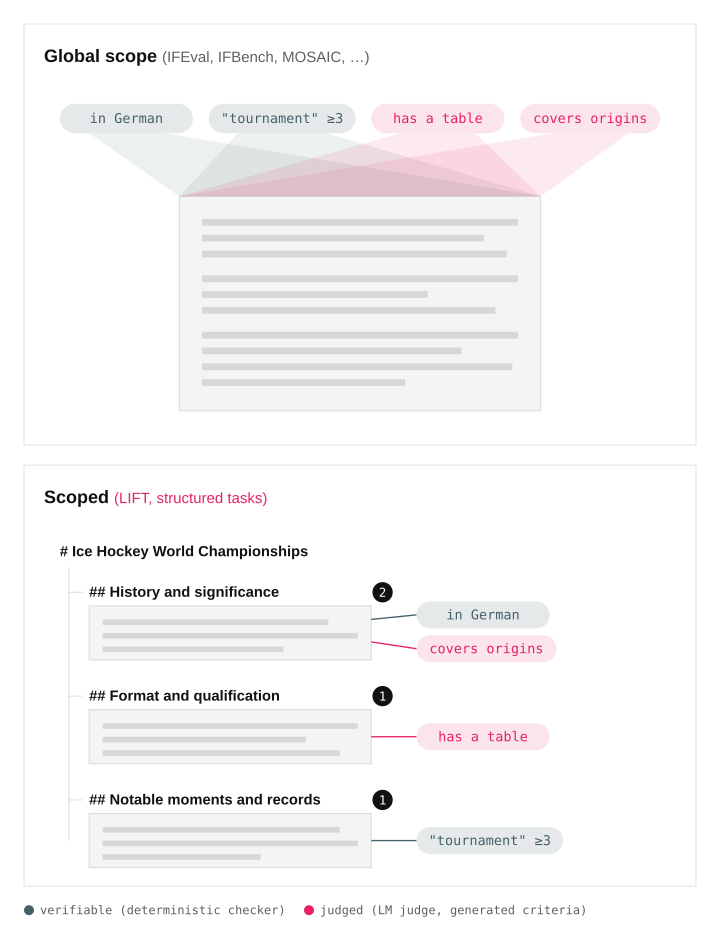

# LIFT-Bench

<!-- TODO before publishing: add the paper badge once the link exists.
     [](TODO) -->
[](https://huggingface.co/datasets/ai21labs/LIFTBench)
[](LICENSE)

Instruction-following benchmark, training set and synthesis pipeline for document-drafting tasks whose
constraints are scoped to individual sections.

**Localized Instruction-Following Tasks (LIFT-Bench)** is a benchmark of synthetic document-drafting tasks. A task
gives the model a topic and an outline — a nested tree of headers whose leaves hold paragraphs, code blocks, tables
and lists — and attaches constraints to individual elements of it.

Every constraint is *scoped*: it is scored only against the element it is attached to. That distinguishes "a
paragraph in French somewhere" from "section 2.1 in French", and makes constraint density a generation parameter
rather than an afterthought.

Each task mixes *verifiable* checks, run in code, with *judged* content requirements, run by an LLM judge, in a
single weighted score. A response that meets every formatting constraint but skips the content still fails every
judged constraint.

<p align="center">
  <picture>
    <source media="(prefers-color-scheme: dark)" srcset="docs/assets/scoping_paradigm_dark.svg">
    
  </picture>
</p>

This repository releases:

- **LIFT-Bench** — 784 tasks over 10 splits, factored by document size, constraint density and scoping, with the
  scoring code that computes the benchmark metric.
- **LIFT-Train** — a 34,258-task training counterpart. In our experiments, training on it was less prone to reward
  hacking than training on lexical-only instruction-following rewards.
- **The synthesis pipeline** that generated both, so new splits can be produced for other domains, densities or
  outline shapes. Tasks are emitted in the format consumed natively by
  [PrimeIntellect's `verifiers`](https://github.com/PrimeIntellect-ai/verifiers), ready for evaluation and RL
  training.

## Quickstart

Requirements: [uv](https://docs.astral.sh/uv/) (it installs Python 3.14 and the locked dependencies and runs
`vf-eval`'s harness) and an OpenAI-compatible endpoint.

```bash
uv sync --locked                       # Python, dependencies and .venv

export OPENAI_BASE_URL=http://localhost:8000/v1   # e.g. a local vLLM server
export OPENAI_API_KEY=...
```

Check the install with the smoke test. One self-contained task, no dataset:

```bash
./run_eval.sh
```

It runs `environments/drafting_constraint_dummy/`, a single task with an emoji-count, a lexical-match and a
case-type constraint. An answer such as `hello there, hope you're having a wonderful day! 😊🌟` meets all three:
the trace comes back with reward 1.0 and `info.agg_eval_scores` `[1.0, 1.0, 1.0]`.

Then run a real split:

```bash
VLLM_MODEL=<model-name> NUM_EXAMPLES=100 ENV_ID=drafting_constraint \
./run_eval.sh --env.taskset.dataset-path <split>/test.jsonl
```

Results land in `.results/<taskset>--<model>--null--<id>/traces.jsonl`, one episode per line. Each trace's `info`
keeps the per-constraint scores and ids (`agg_eval_scores`, `agg_eval_ids`).

> **`run_eval.sh` keeps the run local.** It passes `--env.agent.harness.id null`,
> `--env.agent.runtime.type subprocess` and `--no-push`. Keep those three if you call `vf-eval` directly:
> its defaults are the `bash` harness (a shell for the model), Prime Intellect's cloud sandboxes, and
> **uploading the run to the Prime Intellect platform**.

## The judge

Judged constraints are scored by an LLM. Four things about it matter for a run:

- **Which model.** `Qwen/Qwen2.5-32B-Instruct` for every released split. The name is written into each task
  (`critic_model_name` in the constraint's `metric_args`), not chosen at eval time.
- **How to serve it.** Through `OPENAI_BASE_URL` / `OPENAI_API_KEY` — by default the same endpoint as the model
  under test. Set `VLLM_BASE_URL` and `VLLM_API_KEY` when the model under test lives somewhere else, and the judge
  keeps using `OPENAI_*`.
- **How to point it elsewhere.** Serve a different model at that endpoint under the same name, or rewrite
  `critic_model_name` in the tasks.
- **Comparability.** Scores are only comparable across runs that used the same judge; report which judge was
  served alongside the score.

## Evaluating a model

The `drafting_constraint` taskset (`environments/drafting_constraint`) loads a split and scores each answer with
`constraint_reward`. Beyond the quickstart command, `--env.taskset.system-prompt <file>` adds a system prompt to
every task.

> **Reasoning traces are not stripped.** Checks read the answer's message content as-is, assuming reasoning
> arrived separately (e.g. your server's reasoning parser moved it to `reasoning_content`). A `<think>…</think>`
> block left inline is scored as part of the answer.

### Benchmark data

> ⚠️ **TODO before publishing:** the splits are not downloadable yet. Fill in the download command below and the
> per-split task counts (784 total) once the release location is decided.

```bash
# TODO: download the released splits
```

Ten splits, from three generation runs — short outlines, long outlines, and flat. Within a run every split shares
the same topics and outlines; only the number of constraints attached to them changes. The config behind each one
is in `configs/published_splits/`.

| Split | Config | Outline | Sections with constraints | Verifiable / judged per section |
| --- | --- | --- | --- | --- |
| `short/few` | `structured_l3_d2_sh3_sv2_snv2.yaml` | ≤3 children, 2 levels | ≤3 | ≤2 / ≤2 |
| `short/some` | `structured_l3_d2_sh5_sv3_snv2.yaml` | ≤3 children, 2 levels | ≤5 | ≤3 / ≤2 |
| `short/many` | `structured_l3_d2_sh7_sv3_snv3.yaml` | ≤3 children, 2 levels | ≤7 | ≤3 / ≤3 |
| `short/numerous` | `structured_l3_d2_sh7_sv4_snv4.yaml` | ≤3 children, 2 levels | ≤7 | ≤4 / ≤4 |
| `long/few` | `structured_l5_d2_sh5_sv2_snv2.yaml` | ≤5 children, 2 levels | ≤5 | ≤2 / ≤2 |
| `long/some` | `structured_l5_d2_sh7_sv3_snv2.yaml` | ≤5 children, 2 levels | ≤7 | ≤3 / ≤2 |
| `long/many` | `structured_l5_d2_sh7_sv3_snv3.yaml` | ≤5 children, 2 levels | ≤7 | ≤3 / ≤3 |
| `long/numerous` | `structured_l5_d2_sh7_sv4_snv4.yaml` | ≤5 children, 2 levels | ≤7 | ≤4 / ≤4 |
| `flat/some` | `flat_sv3_snv3.yaml` | none | — | ≤3 / ≤3 per task |
| `flat/many` | `flat_sv5_snv5.yaml` | none | — | ≤5 / ≤5 per task |

**Structured** splits (`short/*`, `long/*`) carry an outline, and each constraint is attached to one leaf section
or to a single artifact within it — a table, list or code block. **Flat** splits have no outline and every
constraint applies to the whole response; this is the regime of existing instruction-following benchmarks,
included for comparison under the same pipeline.

## Training with LIFT-Train

LIFT-Train is the training counterpart: the same row format, the same scoring code, 34,258 tasks.
`constraint_reward` returns a single scalar in `[0, 1]`, so the benchmark metric and the RL reward are the same
number and there is no separate reward model.

The `drafting_constraint` taskset reads a training split the same way it reads a test one, so any
`verifiers`-compatible trainer can use it as its environment:

```bash
PYTHONPATH=.:./environments vf-eval drafting_constraint \
    --env.taskset.dataset-path <split>/train.jsonl ...
```

Two things follow from that:

- **The judge endpoint sits in the training loop.** Every rollout's judged constraints call it, so it has to stay
  up and keep up with rollout throughput.
- **Structured and flat splits train different regimes.** The structured splits train scoping, the flat splits the
  IFEval-style regime. Mix them according to what you evaluate on.

In our experiments, training on constraints that mix judged content requirements with verifiable checks avoided
the failure mode seen when training on lexical-only rewards, where answers collapse into short strings that
satisfy the checkers and draft nothing.

> ⚠️ **TODO before publishing:** no trainer config ships with this repository. Add a pointer to a working RL
> config, or state plainly that one isn't published.

## Generating new tasks

The pipeline that produced both datasets is an async chain of atomic blocks; each reads a JSONL file and writes
another, and a block whose output already exists is skipped, so a run can be resumed or extended from any stage.


1. **Topic seeding** — sample seed topics from Wikipedia's vital articles.
2. **Outline construction** — generate structural skeletons, then have an LLM fill each into a concrete,
   topic-specific outline.
3. **Constraint generation** — parallel per-type generators propose candidate constraints over the outline, one
   block per constraint type, covering the judged and the verifiable family.
4. **Task configuration** — sample each task's constraints from the candidate pool (how many per section, how many
   sections carry any, which types appear), then set the structure/content weight split.
5. **Task verbalization** — render the task as a prompt, structured or flat, and write the train/test split.

```bash
python -m lift_bench.hierarchical_drafting.pipeline.main \
    --config configs/published_splits/structured_l3_d2_sh3_sv2_snv2.yaml \
    --pipeline_infra.max_examples 500 \
    --pipeline_infra.output_dir ./output \
    --doc_outline.document_outline_model_name <model-name> \
    --llm_judge_constraint_generation.content_constraints_model_name <model-name> \
    --llm_judge_constraint_generation.llm_judge_constraint_critic_model_name <model-name> \
    --verifiable_constraint_sampling.keyword_generation_model_name <model-name> \
    --drafting_task.constraint_naturalization_model_name <model-name>
```

Output lands in `<output_dir>/<pipeline_name>/`: one JSONL file per stage, the train/test split under
`TrainTestSplitBlock_<hash>/`, and a `data_summary.txt`. The resulting `test.jsonl` is evaluated exactly like a
released split.

Settings are grouped: flags are `--<group>.<field>`, and a YAML config nests each field under its group. `--config`
loads a file, explicit flags override it, and unknown keys are rejected. List flags take comma-separated values;
boolean flags defaulting to true have a `--no-` form. `Params` in `pipeline/cli.py` defines them all — run with
`--help` for the list. Document topics are the Wikipedia vital-article titles in `data/` (see
[data/README.md](data/README.md)); run from the repo root, or point `--pipeline_infra.seed_topics_path` at another
topics file of the same shape.

Block order, the constraint data model, sampling and verbalization are documented in
[docs/ARCHITECTURE.md](docs/ARCHITECTURE.md).

## Reference

### Constraints

**Judged constraints** are scored by an LLM judge against generated criteria: what content a section should
contain, which artifacts it should include, how those artifacts should be structured.

**Verifiable constraints** are checked deterministically:

| Constraint | What is checked |
| --- | --- |
| `language` | The section is written in the specified language |
| `case_type` | Words satisfy the requested case convention (lower, upper, title) |
| `lexical_count` | A keyword appears a specific number of times |
| `emoji_count` | Emoji count is within `[lower_bound, upper_bound]` |
| `doc_structure` | Section headings match the outline exactly (lexical) |

### Task format

Each task is a JSONL row with two columns consumed by `verifiers`: `prompt` (`list[dict]`, the OpenAI message list
shown to the model) and `info` (`dict`, the rubric forwarded to `constraint_reward`). `info` holds one entry per
constraint:

```json
{
  "evaluations": [
    {
      "evaluation_id": "content_verifiable_constraints_3",
      "weight_group": "content",
      "weight": 0.175,
      "metric_name": "lexical_count",
      "metric_args": { "string": "climate", "lower_bound": 2, "upper_bound": 5 },
      "parser_name": "nested_html",
      "parser_args": { "selector_lst": [["H2", 1]], "is_shallow": false, "document_type": "markdown" }
    }
  ]
}
```

`parser_name` and `parser_args` name the scoped output parser that extracts the targeted section from the full
document before the metric is applied. The full row schema is in
[docs/ARCHITECTURE.md](docs/ARCHITECTURE.md#final-output-schema).

### Scoring

```python
from lift_bench.hierarchical_drafting.metrics.registry import constraint_reward

result = await constraint_reward(completion, info, prompt)
# result["score"]  – weighted aggregate in [0, 1], the benchmark metric and the RL reward
```

Constraints are grouped into **structure** (outline compliance) and **content** (everything else, verifiable and
judged alike); each group's budget is split equally across its constraints. The released structured splits give
structure 10% and content 90%. Flat tasks have no structure constraints, so content takes the full weight.

Per-check scores, the error rules, the metric arguments and the judge's configuration are in
[docs/SCORING.md](docs/SCORING.md). The parser and scoring here are independent implementations measured against
the implementation the benchmark was authored with; coverage and known differences are in
[docs/PARITY.md](docs/PARITY.md).

### Repository layout

```text
lift_bench/hierarchical_drafting/
├── pipeline/           # task synthesis: main.py (block chain), cli.py (settings), blocks/
├── constraints/        # constraint data model and verbalizers
├── document/           # DocumentNode outline tree
├── metrics/            # registered metrics and constraint_reward (registry.py)
├── output_parsers/     # nested_html section parser
└── iftrain/            # IFBench / IFTrain instruction checkers
environments/
├── drafting_constraint/        # verifiers taskset over a split
└── drafting_constraint_dummy/  # one-task smoke-test taskset
configs/published_splits/       # configs behind the released splits
data/                           # seed topics (Wikipedia vital-article titles)
docs/                           # ARCHITECTURE.md, SCORING.md, PARITY.md, diagrams
run_eval.sh                     # local vf-eval wrapper
```

### Development

`source ./init.sh` sets up a contributor environment: `uv sync --locked` plus the pre-commit hooks.

```bash
inv test           # pytest (integration tests excluded)
inv lint --fix     # ruff check
inv formatter --fix
inv staticcheck    # mypy
```

Tests that need an external service are marked `integration` and skipped by default.

## Citation

> ⚠️ **TODO before publishing:** add the paper link and the BibTeX entry, and wire the paper badge at the top.

## License

Apache 2.0, see [LICENSE](LICENSE). The seed topics are Wikipedia article titles, available under
[CC BY-SA 4.0](https://creativecommons.org/licenses/by-sa/4.0/).
